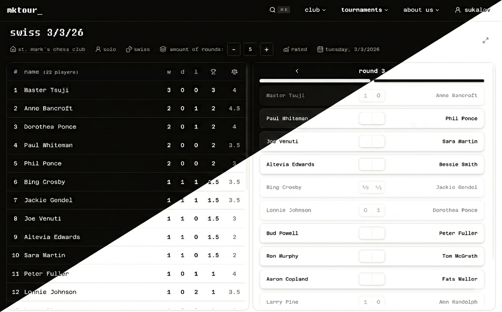

# mktour\_&nbsp;&nbsp;&nbsp;tournament manager for chess clubs



**mktour** — is a modern web application for organizing chess tournaments and networking with chess clubs, integrated with [lichess](https://lichess.org) chess platform. kinda ultimate tool for a chess community

---

### features:

- tournament brackets generation with real-time updates
- mobile first! + PWA support
- it is pretty fast (we optimize, next caching, otimistic updates etc)
- authentication with lichess oauth
- various tools to manage players and tournaments inside a club
- each club has its own rating
- all actions are availible via api
- and finally — **completely** free and open-source (inspired by lichess ofc)

---

### run locally:

needs [bun](https://bun.sh) 1.4.2 and docker with compose.

```sh
bun install
cp .env.example .env
bun dev
```

`bun dev` starts a local postgres (`compose.yaml`, port 5433), applies migrations to its dev and test databases, then serves the app at http://localhost:3000. sign in with lichess: the first login creates your user and club. `bun check` and `bun test` use the test database, so run `bun db:up` first if the dev server isn't running, and again after pulling schema changes.

- `bun db:reset` deletes both local databases and starts fresh
- with your own postgres, point the two urls in `.env` at it and run `bun db:migrate && bun run --bun next dev`
- coming from the turso setup: remove the database variables from `.env.local`, which overrides `.env`

---

сontributions are highly welcome, though we don’t have a decent contribution guide yet
